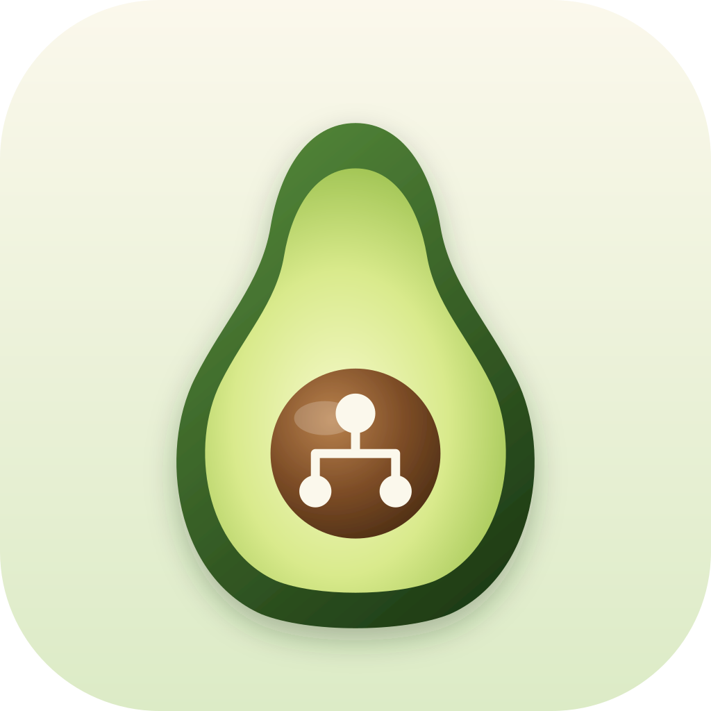
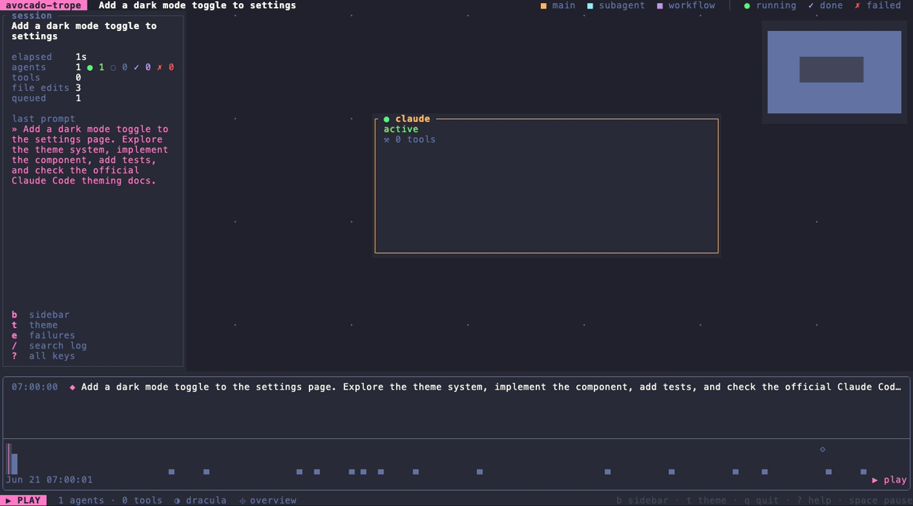
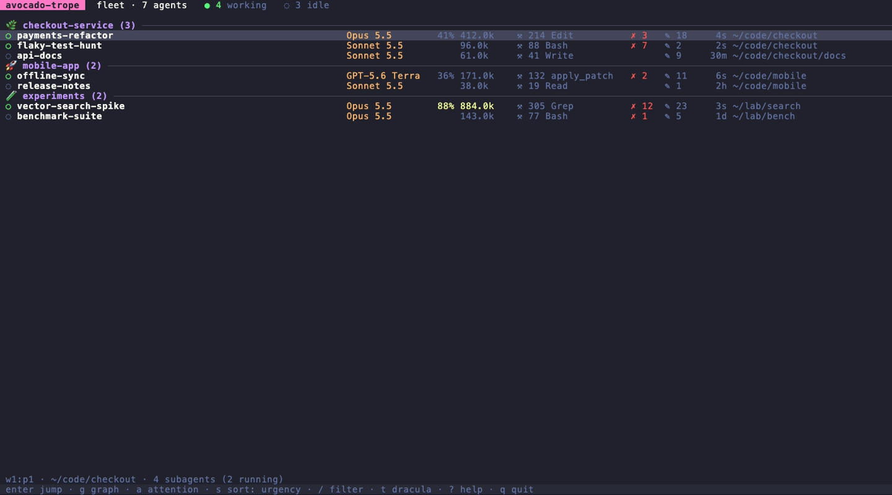
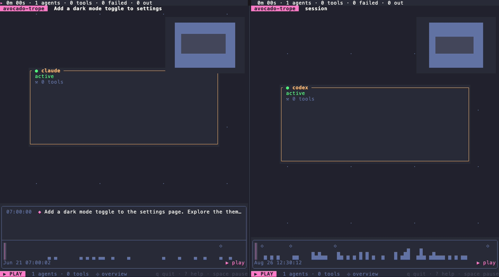

<p align="center"></p>

<h1 align="center">avocado-trope</h1>

<p align="center">
  <a href="https://github.com/furkankly/zoetrope"></a>
  <a href="LICENSE"></a>
  <a href="https://github.com/andymartinezot/avocado-trope"></a>
</p>

**Watch your Claude Code and Codex agents: one session as a live flow graph, or every agent in [herdr](https://herdr.dev) on one screen.**
See who is working, who is stuck, what failed and how full each context is, without opening each pane.

> **This is a fork.** avocado-trope is built on [zoetrope](https://github.com/furkankly/zoetrope) by
> [furkankly](https://github.com/furkankly), which does the hard part: reading the transcripts and
> drawing the graph. The intention here is to improve on it: a clearer look, more of what a session
> records on screen, and tools for running many agents at once. All credit for the original goes
> to its author. See [What this fork adds](#what-this-fork-adds).

| | |
|---|---|
| **Session graph** | The main agent, the agents it spawned and their tools, live or replayed, with a summary sidebar and a session log |
| **Fleet** | Every herdr agent on one screen: status, model, context, last tool, failures, files. Jump to a pane or open its graph |
| **Warnings** | Stuck tool calls, agents waiting on you, and context windows filling up |
| **Compare** | Two sessions side by side on one clock |
| **Export** | A session as JSON or Markdown, for scripts and pull requests |
| **Agents** | Claude Code and Codex |
| **Runs on** | macOS and Linux. The graph needs only a terminal; the fleet needs herdr 0.9.3+ |

---

## Contents

- [What this fork adds](#what-this-fork-adds)
- [Demo](#demo)
- [Quick start](#quick-start)
- [The session graph](#the-session-graph)
- [Fleet](#fleet)
- [Compare two sessions](#compare-two-sessions)
- [Export a session](#export-a-session)
- [Themes](#themes)
- [How it works](#how-it-works)
- [CLI reference](#cli-reference)
- [Safety](#safety)
- [State and privacy](#state-and-privacy)
- [Troubleshooting](#troubleshooting)
- [Develop](#develop)
- [Credits](#credits)

---

## What this fork adds

zoetrope reads a session's transcript and draws it as a graph you can replay and scrub. Everything
below is added on top of that.

| Area | Added here |
|---|---|
| Look | Cards colored by role, the model on every card, a header with a legend, 7 themes |
| Session detail | Context in use, a session sidebar, a multi-row session log with search, the session's own name as its title |
| Failures | The error text of failed calls, and a lens that shows only failures |
| Files | Which files each agent changed, and which it created |
| Warnings | Stuck tool calls, and context use colored as a known window fills |
| Many agents | The fleet view, with herdr notifications |
| Analysis | Side-by-side comparison, JSON and Markdown export |

The browser build from zoetrope is still in the repository, but this fork doesn't work on it: the
new keys and screens are terminal only.

---

## Demo



In the recording:

1. A session replays. The sidebar sums it up and the log lists each tool call as it lands.
2. `e` shows only failures, with what each one reported.
3. `/` searches the log.
4. Selecting an agent opens its detail panel.
5. `t` switches theme.



Agents change state as it runs: one starts waiting on you, one gets stuck, one's context nears its
limit. Then `a` keeps only who needs you, `s` changes the sort, `/` filters, and `g` opens a graph.



Two sessions replay on one clock, with their totals on top.

All recordings use the demo sessions in [`assets/`](assets), so they never show real work.

---

## Quick start

You need [Rust](https://rustup.rs) 1.88 or newer. There are no release binaries yet.

```sh
git clone https://github.com/andymartinezot/avocado-trope
cd avocado-trope
cargo build --release
./target/release/zoe assets/claude/demo.jsonl    # the bundled demo session
```

The binary is still called `zoe`, so it works with what zoetrope's herdr bridge expects. To use it
anywhere, run `cargo install --path .`. If upstream's `zoe` is also installed, check which one comes
first on your `PATH`.

```sh
zoe                 # follow the live session of the current folder
zoe <id>            # replay a session by id, or a unique prefix of one
zoe <file.jsonl>    # replay a session file
zoe fleet           # every agent in herdr
```

### With herdr

Link the plugin from your clone. Its panes run `target/release/zoe` from that same clone, so a new
`cargo build --release` is all an update needs.

```sh
herdr plugin link herdr-plugin
herdr integration install claude    # so herdr knows each pane's session id
herdr integration install codex     # optional, for Codex
```

Then add keys to `~/.config/herdr/config.toml`, using keys that are free in your setup:

```toml
[[keys.command]]
key = "prefix+shift+a"
type = "shell"
command = "herdr plugin pane open --plugin andymartinezot.avocado-trope --entrypoint graph --placement zoomed"
description = "avocado-trope: session graph"

[[keys.command]]
key = "prefix+shift+e"
type = "shell"
command = "herdr plugin pane open --plugin andymartinezot.avocado-trope --entrypoint fleet --placement zoomed"
description = "avocado-trope: every agent"
```

Run `herdr server reload-config` after adding them. `q` closes either screen.

---

## The session graph

| Part | Shows |
|---|---|
| **Header** | The session's name, the main model, and a legend |
| **Cards** | Border color is the role, the glyph on it is the state. Model, description, last tool, context and output tokens |
| **Sidebar** | Elapsed time, agents by state, tool calls and failures, context, output, files changed, stuck agents, your last prompt, and the main keys. Inside herdr it also lists the keys you bound to avocado-trope, read from your config |
| **Session log** | The latest tool calls and prompts across all agents, in windows 30 rows tall or more |
| **Timeline** | Scrub anywhere. The sidebar and the log rewind with it |

| Key | Action |
|---|---|
| `space` | Pause or resume |
| `[` `]` | Previous or next prompt |
| `g` / `End` | Go live |
| `s` | Skip idle gaps on or off |
| `tab`, arrows, click | Select an agent and open its detail panel |
| `o` / `f` / `r` | Overview / follow the active agent / rearrange |
| `e` | Log: failures only, showing what each one reported |
| `/` | Log: search. `enter` keeps the filter, `esc` clears it |
| `b` / `B` | Sidebar on or off / pin it in narrow windows |
| `t` | Next theme |
| `i` / `?` | Session details / all keys |
| `q` | Quit |

### Warnings

- **Stuck:** an agent with a tool call open and no new records for 5 minutes (`--stuck-after`) gets
  a `⚠` on its card, naming the tool. A call that spawned an agent doesn't count, because it stays
  open for that agent's whole life. Neither does one left open for more than a day: that's an
  interrupted session, not a hang.
- **Context:** the figure turns yellow at 70% of the window and red at 90%.

The percentage needs the window size. Codex records it. Claude Code doesn't, and a model id doesn't
tell you, so avocado-trope won't guess: it shows the token count alone until you set
`--context-window`, or until a session passes 200k, which proves a 1M window.

---

## Fleet

```sh
zoe fleet
```

One row per agent, grouped by workspace in herdr's order. Inside a workspace, whoever needs you comes
first: waiting on you, then stuck, working, done and idle.

| Key | Action |
|---|---|
| `↑` `↓` `j` `k` | Move. A click selects, a second click jumps |
| `enter` | Jump to the agent's pane in herdr |
| `g` | Open its session graph. `q` comes back |
| `a` | Only agents that need you |
| `s` | Sort by urgency, last activity or context |
| `/` | Filter by name, workspace or folder |
| `t` / `?` / `q` | Next theme / help / quit |

Columns drop out as the window narrows, least useful first. With `--notify`, herdr shows a
notification when an agent starts waiting on you or gets stuck, once per change. `zoe fleet --json`
prints one snapshot for scripts.

In the fleet, only an agent herdr reports as working can be stuck, and one with no open call counts
too when its transcript has been quiet for the `--stuck-after` time. That can be a long think rather
than a hang, so treat `⚠` as "take a look".

### Cost

Measured on a laptop, in a 150×45 terminal, polling every 2 seconds:

| Fleet | First read | CPU | Memory | Key response |
|---|---|---|---|---|
| 10 real agents, about 100 MB of transcripts | 0.8 s | 0.4% | under 100 MB, flat | 2 ms |
| 100 agents, 1 GB of transcripts, quiet | 3.5 s | 1.1% | 139 MB, flat | 2 ms |
| 100 agents, 1 GB, 25 of them writing 890 lines/s | 3.5 s | 1.4% | 376 MB, grows with the data | 2 ms |

The screen works during the first read: rows appear as each session finishes.

---

## Compare two sessions

```sh
zoe compare <session-a> <session-b> --speed 8
```

Both start from their first record at the same speed, and wait until both are loaded. At any moment
each side shows the same time since it began, so you can see which got there first and at what cost.
Useful for the same task on two models. The bar on top shows each side's elapsed time, agents, tools,
failures and output.

`space`, `[` `]`, `g`, `b`, `e` and `/` act on both sides. Selecting and panning act on the focused
side, marked `▸`: `w` swaps it, or click. `s` is off here, since skipping idle gaps would break the
shared clock.

---

## Export a session

```sh
zoe inspect <id>                       # readable tree
zoe inspect --json <id>                # agents, tools, failures, files, prompts
zoe inspect --markdown <id> > run.md   # a summary to paste into a pull request
```

Exports hold what the session holds, including prompts, file paths and error text, which can contain
secrets. Read them before sharing.

---

## Themes

`dracula` (default), `catppuccin`, `tokyo-night`, `gruvbox`, `nord`, `classic` (the original zoetrope
look) and `terminal` (your terminal's own colors, which also suits light themes).

Press `t` to switch; your choice is remembered. Otherwise the first of these that applies wins:

1. `--theme <name>`
2. `$ZOE_THEME`
3. The theme you last picked with `t`
4. herdr's theme, when running inside a herdr pane
5. `dracula`

Names from other tools work too (`catppuccin-mocha`, `tokyo-night-storm`), and light variants map to
`terminal`. `zoe --theme list` prints the names.

---

## How it works

Claude Code and Codex write a transcript for every session. Each format enters through one boundary,
[`src/provider/`](src/provider), which turns records into format-free facts ([`src/fact.rs`](src/fact.rs)).
A fold builds the session model from those facts, and the graph, sidebar, log, fleet and exports all
read that model.

The fleet asks herdr who is running (`herdr agent list`, a few milliseconds), parses each transcript
once and then reads only what was appended. That work runs on a background task that publishes
finished rows, and the screen redraws only when a row changes.

See [`docs/ARCHITECTURE.md`](docs/ARCHITECTURE.md) and [`docs/DESIGN.md`](docs/DESIGN.md), both from
zoetrope, for the design of the core.

---

## CLI reference

| Command | Does |
|---|---|
| `zoe` | Follow the current folder's live session |
| `zoe <file\|id\|dir>` | Replay a file or session, or follow another folder |
| `zoe fleet` | Every herdr agent on one screen |
| `zoe compare <a> <b>` | Two sessions side by side |
| `zoe inspect <file\|id\|dir>` | Print a session, no TUI |

| Flag | Applies to | Does |
|---|---|---|
| `--follow` | `zoe` | Start at the live edge instead of the beginning |
| `--speed N` | `zoe`, `compare` | Replay speed (default 8) |
| `--provider <name>` | `zoe`, `inspect` | Force `claude` or `codex` |
| `--theme <name\|list>` | all | Color theme, or print the names |
| `--stuck-after N` | `zoe`, `fleet`, `compare` | Minutes before an open tool call is stuck (default 5) |
| `--context-window N` | all | Window in tokens, for agents whose format doesn't state one |
| `--interval N` | `fleet` | Seconds between polls (default 2) |
| `--notify` | `fleet` | Notify through herdr when an agent starts needing you |
| `--json` | `fleet`, `inspect` | Print JSON and exit |
| `--markdown` | `inspect` | Print Markdown and exit |
| `--demo <file>` | `fleet` | Made-up rows from a file, for recordings |

---

## Safety

- **Never touches your sessions:** transcripts are only read. It can't type into an agent or change
  a pane. `enter` only moves focus.
- **No network:** nothing in the program opens a connection, and there is no telemetry.
- **Only starts two programs:** `zoe fleet` runs `herdr`, and `g` runs `zoe` itself. Both use fixed
  arguments with no shell, and herdr calls are killed after 5 seconds. Session text never reaches a
  shell; a notification's text is passed as a single argument.
- **Cleans what it shows:** transcripts can hold anything, so control characters are dropped before
  they reach your terminal.
- **Built from source:** with no release binaries, what runs is what you compiled.

---

## State and privacy

avocado-trope reads `~/.claude/projects`, `~/.codex/sessions` and, inside herdr, herdr's config: the
theme, and the keys that open avocado-trope.

The only file it writes is `~/.config/avocado-trope/theme` (or `$XDG_CONFIG_HOME/avocado-trope`),
holding the name of the theme you picked. Session content stays on your machine. Prompts and tool
output do appear on screen, so mind what you share while it's open.

---

## Troubleshooting

| Symptom | Fix |
|---|---|
| The fleet says it can't run herdr | Install herdr, or set `HERDR_BIN_PATH` to it |
| A fleet row has no model or context | herdr doesn't know that pane's session yet. Run `herdr integration install claude`, then restart that agent |
| No context percentage | Claude Code doesn't record the window. Pass `--context-window 1000000` |
| An agent shows `⚠` but is fine | A long command or a long think. Raise `--stuck-after` |
| The session log is one line | The window is under 30 rows. `e` and `/` still open a taller log from 20 rows |
| The sidebar is missing | The window is under 110 columns, or a detail panel is open. `B` pins it down to 60 |
| The theme ignores herdr | You picked one with `t`, which wins. Delete `~/.config/avocado-trope/theme` |
| herdr opens the old look | Its pane runs `target/release/zoe` from your clone: run `cargo build --release` |

---

## Develop

```sh
cargo test
cargo clippy --all-targets
cargo fmt
cargo run -- assets/claude/demo.jsonl
cargo run -- fleet --demo assets/fleet/demo.json   # made-up agents, no herdr needed
UPDATE_GOLDEN=1 cargo test                         # after an intended change to parsing
vhs scripts/demo/fleet.tape                        # re-record a GIF (brew install vhs)
```

Commits follow [Conventional Commits](https://www.conventionalcommits.org). To bring in upstream
work: `git remote add upstream https://github.com/furkankly/zoetrope`, then `git fetch upstream` and
merge.

---

## Credits

avocado-trope exists because of [zoetrope](https://github.com/furkankly/zoetrope) by
[furkankly](https://github.com/furkankly), and the [rataflow](https://github.com/furkankly/rataflow)
and [ratatui](https://ratatui.rs) libraries it stands on. If you only want the session graph, or
want it in your browser, use the [original](https://zoetrope.furkankly.dev).

## License

MIT, like zoetrope. See [LICENSE](LICENSE).
